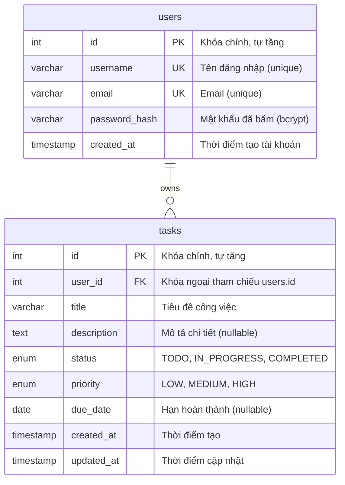
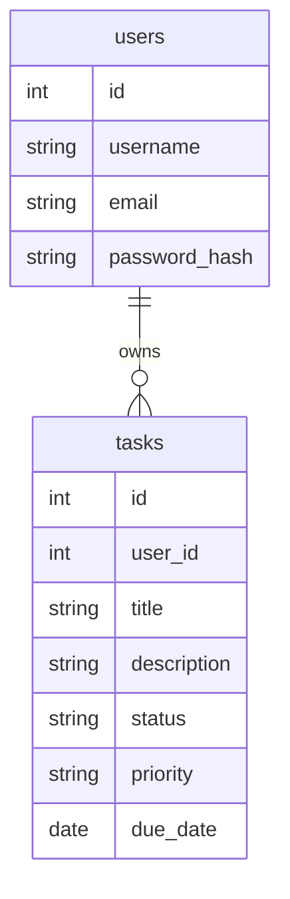
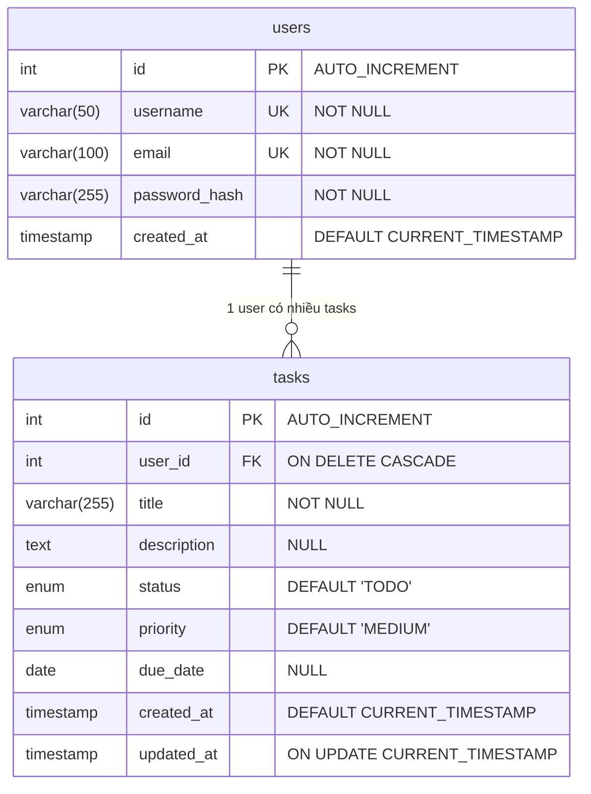
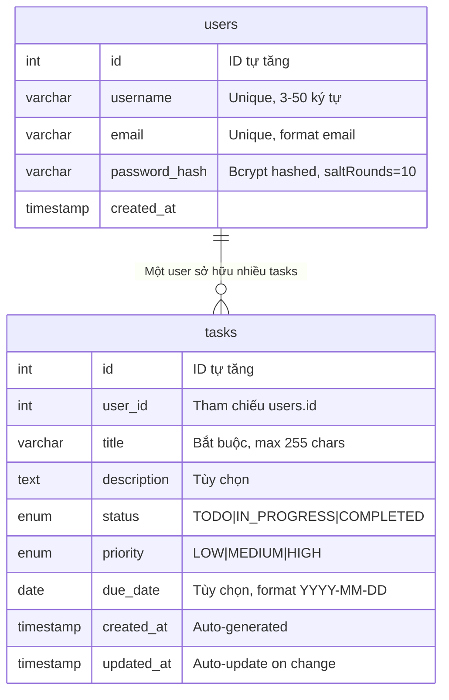
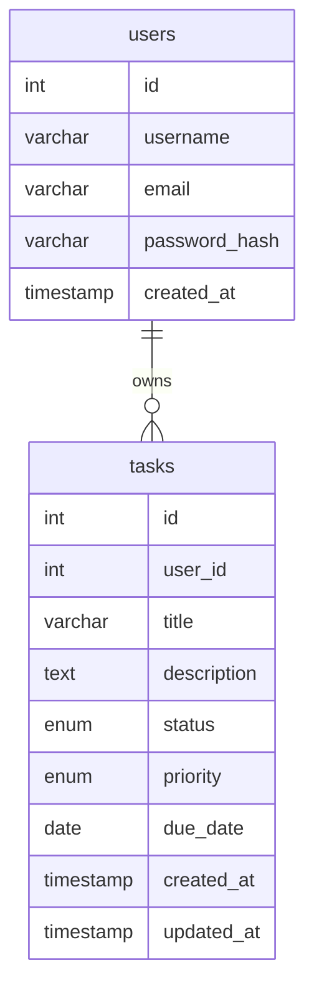
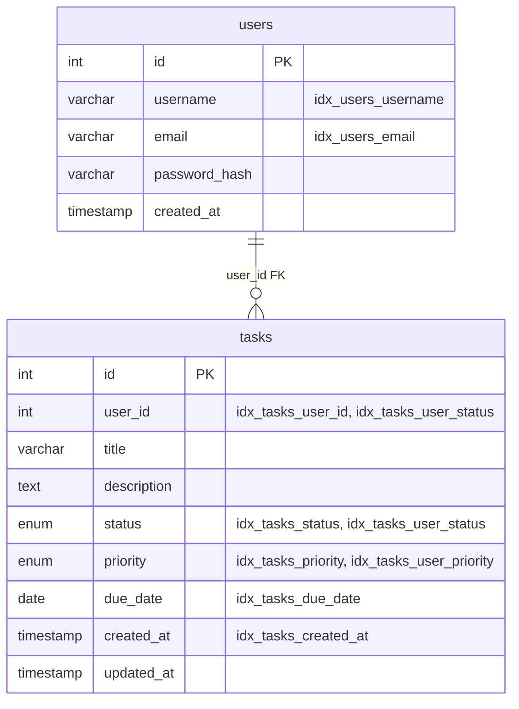
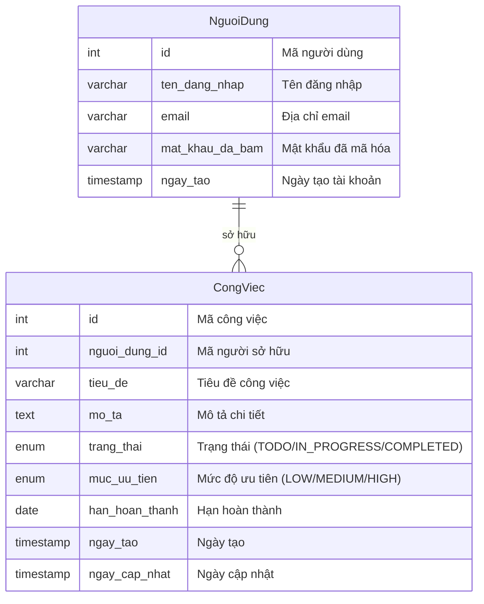
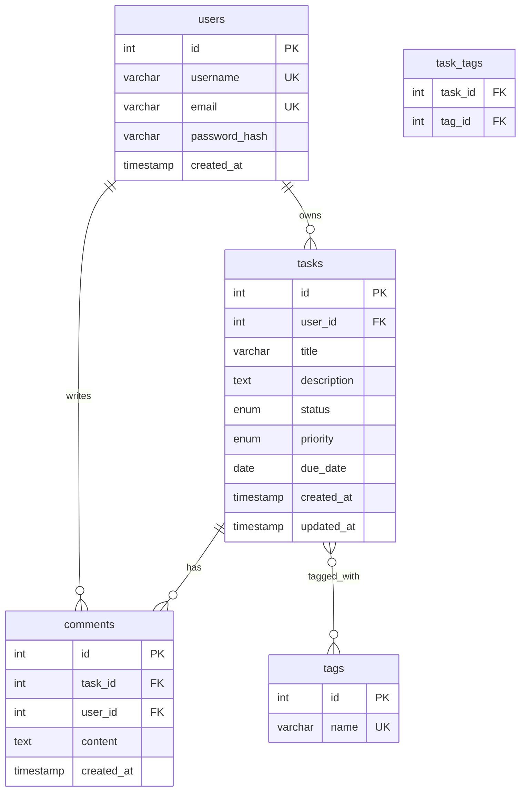

# Sơ đồ Cơ sở Dữ liệu - Mermaid ERD

## Sơ đồ ERD đầy đủ



---

## Sơ đồ đơn giản (cho slide thuyết trình)



---

## Sơ đồ với index và constraints



---

## Sơ đồ với mô tả quan hệ



---

## Sơ đồ với dữ liệu mẫu (cho demo)



**Dữ liệu mẫu:**

**Bảng users:**
| id | username | email |
|----|----------|-------|
| 1 | nguyenvana | nguyenvana@example.com |
| 2 | tranthib | tranthib@example.com |

**Bảng tasks:**
| id | user_id | title | status | priority |
|----|---------|-------|--------|----------|
| 1 | 1 | Hoàn thành báo cáo Express.js | IN_PROGRESS | HIGH |
| 2 | 1 | Nghiên cứu Middleware | COMPLETED | MEDIUM |
| 3 | 2 | Học Node.js cơ bản | COMPLETED | HIGH |

---

## Sơ đồ với các index



**Các index được tạo:**
- `idx_users_username` trên `users.username`
- `idx_users_email` trên `users.email`
- `idx_tasks_user_id` trên `tasks.user_id`
- `idx_tasks_status` trên `tasks.status`
- `idx_tasks_priority` trên `tasks.priority`
- `idx_tasks_due_date` trên `tasks.due_date`
- `idx_tasks_created_at` trên `tasks.created_at`
- `idx_tasks_user_status` trên `(user_id, status)` - composite
- `idx_tasks_user_priority` trên `(user_id, priority)` - composite

---

## Sơ đồ tiếng Việt (cho báo cáo)



---

## Cách sử dụng trong báo cáo

### Trong file Markdown:

Chỉ cần copy code block trên và paste vào file `.md`:

\`\`\`mermaid
erDiagram
    users ||--o{ tasks : owns
    ...
\`\`\`

### Trong GitHub/GitLab:
Các nền tảng này tự động render Mermaid diagrams.

### Trong Word/PowerPoint:
1. Vào https://mermaid.live/
2. Paste code Mermaid vào
3. Export as PNG/SVG
4. Chèn vào Word/PowerPoint

### Trong LaTeX:
Sử dụng package `mermaid-cli`:
```bash
npm install -g @mermaid-js/mermaid-cli
mmdc -i diagram.mmd -o diagram.png
```

---

## Giải thích ký hiệu

### Quan hệ (Cardinality):

| Ký hiệu | Ý nghĩa | Ví dụ |
|---------|---------|-------|
| `||--o{` | One-to-Many | 1 user có nhiều tasks |
| `||--||` | One-to-One | 1 user có 1 profile |
| `}o--o{` | Many-to-Many | Many users - Many roles |

### Chú thích trường:

| Chú thích | Ý nghĩa |
|-----------|---------|
| `PK` | Primary Key (Khóa chính) |
| `FK` | Foreign Key (Khóa ngoại) |
| `UK` | Unique Key (Ràng buộc duy nhất) |

---

## Sơ đồ mở rộng (cho hướng phát triển tương lai)



---

## Lưu ý khi sử dụng

1. **Chọn sơ đồ phù hợp:**
   - Báo cáo chi tiết → Dùng sơ đồ đầy đủ với constraints
   - Slide thuyết trình → Dùng sơ đồ đơn giản
   - Demo → Dùng sơ đồ với dữ liệu mẫu

2. **Render Mermaid:**
   - GitHub/GitLab tự động render
   - Markdown viewers như Typora, VS Code preview
   - Online: https://mermaid.live/

3. **Export:**
   - PNG cho Word/PowerPoint
   - SVG cho chất lượng cao
   - PDF cho in ấn

---

## Tool hỗ trợ

- **Mermaid Live Editor**: https://mermaid.live/
- **VS Code Extension**: Markdown Preview Mermaid Support
- **CLI**: `npm install -g @mermaid-js/mermaid-cli`

---

Chúc bạn thành công với báo cáo! 🚀
