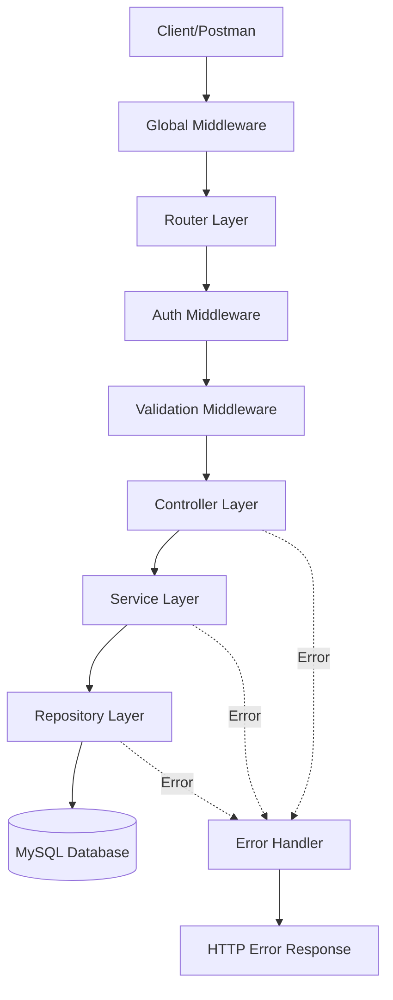
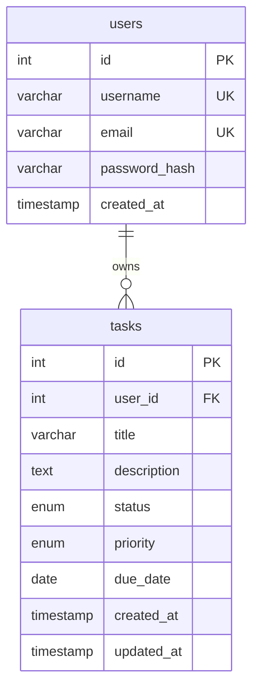
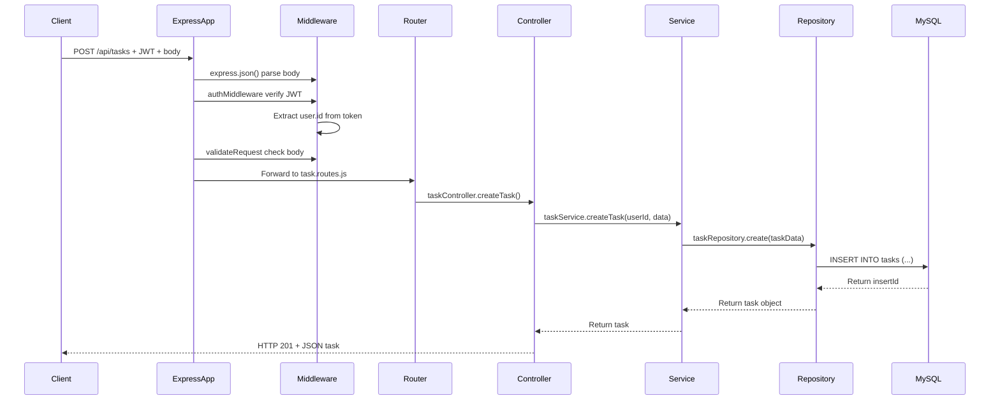

# HỆ THỐNG QUẢN LÝ CÔNG VIỆC (TASK MANAGEMENT SYSTEM)

**Báo cáo môn học:** Các công nghệ lập trình hiện đại  
**Trường:** Đại học Sài Gòn (SGU)  
**Công nghệ:** Node.js, Express.js, MySQL, RESTful API

---

## 📋 MỤC LỤC

1. [Giới thiệu](#giới-thiệu)
2. [Lý do chọn Node.js và Express.js](#lý-do-chọn-nodejs-và-expressjs)
3. [Kiến trúc hệ thống](#kiến-trúc-hệ-thống)
4. [Công nghệ sử dụng](#công-nghệ-sử-dụng)
5. [Cơ sở dữ liệu](#cơ-sở-dữ-liệu)
6. [Cài đặt và chạy hệ thống](#cài-đặt-và-chạy-hệ-thống)
7. [Danh sách API](#danh-sách-api)
8. [Kiểm thử](#kiểm-thử)
9. [Luồng dữ liệu thực tế](#luồng-dữ-liệu-thực-tế)
10. [Hạn chế và hướng phát triển](#hạn-chế-và-hướng-phát-triển)

---

## 🎯 GIỚI THIỆU

Hệ thống quản lý công việc (Task Management System) là một ứng dụng web RESTful API được xây dựng bằng Node.js và Express.js, cho phép người dùng quản lý các công việc cá nhân với đầy đủ chức năng CRUD, tìm kiếm, lọc, sắp xếp và phân trang.

### Mục tiêu dự án

Đây không chỉ là một dự án CRUD đơn giản. Mục tiêu quan trọng nhất là **chứng minh việc áp dụng kiến trúc phân lớp** trong một ứng dụng Express.js có thể chạy thực tế, phục vụ báo cáo môn học.

### Tính năng chính

- ✅ **Quản lý tài khoản**: Đăng ký, đăng nhập, xác thực JWT
- ✅ **CRUD công việc**: Tạo, đọc, cập nhật, xóa task
- ✅ **Tìm kiếm và lọc**: Theo tiêu đề, trạng thái, mức độ ưu tiên
- ✅ **Sắp xếp và phân trang**: Linh hoạt với nhiều tiêu chí
- ✅ **Bảo mật**: JWT Authentication, bcrypt password hashing
- ✅ **Kiến trúc phân lớp**: Router → Controller → Service → Repository
- ✅ **Validation**: Kiểm tra dữ liệu đầu vào bằng express-validator
- ✅ **Error Handling**: Xử lý lỗi tập trung, thống nhất

---

## 🤔 LÝ DO CHỌN NODE.JS VÀ EXPRESS.JS

### Node.js

1. **JavaScript toàn stack**: Sử dụng cùng một ngôn ngữ cho cả frontend và backend
2. **Event-driven, non-blocking I/O**: Xử lý hiệu quả các tác vụ bất đồng bộ như database queries
3. **Hệ sinh thái phong phú**: npm với hàng triệu package
4. **Cộng đồng lớn**: Tài liệu, hướng dẫn và giải pháp phong phú
5. **Phù hợp với microservices**: Dễ dàng mở rộng và triển khai

### Express.js

1. **Minimalist và linh hoạt**: Không áp đặt cấu trúc cứng nhắc
2. **Middleware pattern**: Dễ dàng tổ chức và mở rộng chức năng
3. **Routing mạnh mẽ**: Hỗ trợ RESTful API một cách tự nhiên
4. **Cộng đồng và tài liệu**: Framework Node.js phổ biến nhất
5. **Hiệu suất cao**: Overhead thấp, phù hợp cho ứng dụng real-time

---

## 🏗️ KIẾN TRÚC HỆ THỐNG

Hệ thống được xây dựng theo kiến trúc phân lớp (Layered Architecture) rõ ràng:

```
Client / Postman
    ↓
Global Middleware (Helmet, CORS, JSON Parser, Request Logger)
    ↓
Router (Khai báo endpoint và HTTP method)
    ↓
Authentication Middleware (Xác thực JWT)
    ↓
Validation Middleware (Kiểm tra dữ liệu đầu vào)
    ↓
Controller (Xử lý HTTP request/response)
    ↓
Service (Logic nghiệp vụ)
    ↓
Repository (Truy vấn database)
    ↓
MySQL Database
```

### Sơ đồ kiến trúc



### Vai trò từng tầng

| Tầng | Trách nhiệm | Không được phép |
|------|-------------|-----------------|
| **Router** | Khai báo endpoint, HTTP method, gắn middleware | Chứa logic nghiệp vụ, SQL |
| **Middleware** | Xác thực, validation, logging, error handling | Truy vấn database trực tiếp |
| **Controller** | Đọc request, gọi Service, trả response | Chứa logic nghiệp vụ, SQL |
| **Service** | Logic nghiệp vụ, phối hợp Repository | Xử lý HTTP request/response |
| **Repository** | Truy vấn và thao tác MySQL | Chứa logic nghiệp vụ, HTTP |

### Cấu trúc thư mục

```
task-management-system/
├── src/
│   ├── config/
│   │   └── database.js              # Cấu hình kết nối MySQL
│   ├── controllers/
│   │   ├── auth.controller.js       # Controller xác thực
│   │   └── task.controller.js       # Controller quản lý task
│   ├── services/
│   │   ├── auth.service.js          # Service xác thực
│   │   └── task.service.js          # Service quản lý task
│   ├── repositories/
│   │   ├── user.repository.js       # Repository user
│   │   └── task.repository.js       # Repository task
│   ├── routes/
│   │   ├── auth.routes.js           # Routes xác thực
│   │   └── task.routes.js           # Routes task
│   ├── middlewares/
│   │   ├── authMiddleware.js        # JWT authentication
│   │   ├── validateRequest.js       # Validation middleware
│   │   ├── requestLogger.js         # Request logging
│   │   ├── notFoundHandler.js       # 404 handler
│   │   └── errorHandler.js          # Error handler tập trung
│   ├── validators/
│   │   ├── auth.validator.js        # Validation rules cho auth
│   │   └── task.validator.js        # Validation rules cho task
│   ├── utils/
│   │   └── ApiError.js              # Lớp lỗi tùy chỉnh
│   ├── app.js                       # Cấu hình Express app
│   └── server.js                    # Entry point, khởi động server
├── database/
│   ├── schema.sql                   # Database schema
│   └── seed.sql                     # Dữ liệu mẫu
├── tests/
│   ├── auth.test.js                 # Test authentication API
│   └── task.test.js                 # Test task API
├── .env.example                     # Template biến môi trường
├── .gitignore
├── package.json
├── jest.config.js
└── README.md
```

---

## 🛠️ CÔNG NGHỆ SỬ DỤNG

### Dependencies chính

| Package | Version | Mục đích |
|---------|---------|----------|
| **express** | ^5.1.0 | Web framework |
| **mysql2** | ^3.12.0 | MySQL client với Promise API |
| **bcrypt** | ^5.1.1 | Băm mật khẩu |
| **jsonwebtoken** | ^9.0.2 | JWT authentication |
| **express-validator** | ^7.2.1 | Validation dữ liệu đầu vào |
| **helmet** | ^8.1.0 | HTTP security headers |
| **cors** | ^2.8.5 | Cross-Origin Resource Sharing |
| **morgan** | ^1.10.0 | HTTP request logger |
| **dotenv** | ^16.4.7 | Quản lý biến môi trường |

### DevDependencies

| Package | Version | Mục đích |
|---------|---------|----------|
| **jest** | ^29.7.0 | Testing framework |
| **supertest** | ^7.1.0 | HTTP assertions cho API testing |

---

## 💾 CƠ SỞ DỮ LIỆU

### Mô hình ERD



### Bảng users

| Cột | Kiểu dữ liệu | Ràng buộc | Mô tả |
|-----|--------------|-----------|-------|
| id | INT | PRIMARY KEY, AUTO_INCREMENT | ID tự tăng |
| username | VARCHAR(50) | UNIQUE, NOT NULL | Tên đăng nhập |
| email | VARCHAR(100) | UNIQUE, NOT NULL | Email |
| password_hash | VARCHAR(255) | NOT NULL | Mật khẩu đã băm (bcrypt) |
| created_at | TIMESTAMP | DEFAULT CURRENT_TIMESTAMP | Thời điểm tạo |

### Bảng tasks

| Cột | Kiểu dữ liệu | Ràng buộc | Mô tả |
|-----|--------------|-----------|-------|
| id | INT | PRIMARY KEY, AUTO_INCREMENT | ID tự tăng |
| user_id | INT | FOREIGN KEY, NOT NULL | Người sở hữu task |
| title | VARCHAR(255) | NOT NULL | Tiêu đề công việc |
| description | TEXT | NULL | Mô tả chi tiết |
| status | ENUM | NOT NULL, DEFAULT 'TODO' | Trạng thái (TODO, IN_PROGRESS, COMPLETED) |
| priority | ENUM | NOT NULL, DEFAULT 'MEDIUM' | Mức độ ưu tiên (LOW, MEDIUM, HIGH) |
| due_date | DATE | NULL | Hạn hoàn thành |
| created_at | TIMESTAMP | DEFAULT CURRENT_TIMESTAMP | Thời điểm tạo |
| updated_at | TIMESTAMP | DEFAULT CURRENT_TIMESTAMP ON UPDATE | Thời điểm cập nhật |

### Index

- `idx_users_username` trên `users.username`
- `idx_users_email` trên `users.email`
- `idx_tasks_user_id` trên `tasks.user_id`
- `idx_tasks_status` trên `tasks.status`
- `idx_tasks_priority` trên `tasks.priority`
- `idx_tasks_user_status` trên `(user_id, status)`
- `idx_tasks_user_priority` trên `(user_id, priority)`

---

## ⚙️ CÀI ĐẶT VÀ CHẠY HỆ THỐNG

### Yêu cầu hệ thống

- **Node.js** >= 18.x LTS
- **MySQL** >= 8.0
- **npm** hoặc **yarn**
- **Windows 10/11** (hướng dẫn cho Windows)

### Bước 1: Cài đặt Node.js

1. Tải Node.js LTS từ: https://nodejs.org/
2. Cài đặt với tùy chọn mặc định
3. Kiểm tra cài đặt:

```bash
node --version
npm --version
```

### Bước 2: Cài đặt MySQL

1. Tải MySQL từ: https://dev.mysql.com/downloads/mysql/
2. Cài đặt MySQL Server và MySQL Workbench
3. Ghi nhớ mật khẩu root

### Bước 3: Tạo database

1. Mở MySQL Workbench hoặc command line:

```bash
mysql -u root -p
```

2. Chạy file schema để tạo database và bảng:

```sql
SOURCE D:/C/user/Desktop/ccnlthd/CCNLTHD/database/schema.sql
```

3. (Tùy chọn) Chạy file seed để thêm dữ liệu mẫu:

```sql
SOURCE D:/C/user/Desktop/ccnlthd/CCNLTHD/database/seed.sql
```

**Lưu ý về dữ liệu mẫu:**
- Mật khẩu gốc trong seed data là: `Password123!`
- Mật khẩu đã được băm bằng bcrypt với saltRounds = 10
- Có 2 user mẫu: `nguyenvana` và `tranthib`

### Bước 4: Cấu hình biến môi trường

1. Sao chép file `.env.example` thành `.env`:

```bash
copy .env.example .env
```

2. Mở file `.env` và điền thông tin:

```env
# Server
PORT=3000
NODE_ENV=development

# MySQL Database
DB_HOST=localhost
DB_PORT=3306
DB_USER=root
DB_PASSWORD=your_mysql_password_here
DB_NAME=task_management

# JWT
JWT_SECRET=your_secret_key_change_in_production_min_32_chars
JWT_EXPIRES_IN=24h

# Bcrypt
BCRYPT_SALT_ROUNDS=10

# CORS
CORS_ORIGIN=*
```

**Lưu ý bảo mật:**
- Đặt `JWT_SECRET` dài ít nhất 32 ký tự
- Không commit file `.env` vào Git
- Trong production, đổi `CORS_ORIGIN` thành domain cụ thể

### Bước 5: Cài đặt dependencies

**Quan trọng:** Đảm bảo có đủ dung lượng ổ đĩa (ít nhất 500MB trống).

```bash
cd D:\C\user\Desktop\ccnlthd\CCNLTHD
npm install
```

**Nếu gặp lỗi "ENOSPC: no space left on device":**
1. Giải phóng dung lượng ổ đĩa
2. Xóa thư mục `node_modules` và file `package-lock.json` (nếu có)
3. Chạy lại `npm install`

**Nếu cài đặt chậm:**
```bash
npm install --legacy-peer-deps
```

### Bước 6: Chạy server

**Chế độ production:**
```bash
npm start
```

**Chế độ development (auto-restart khi code thay đổi):**
```bash
npm run dev
```

Khi server chạy thành công, bạn sẽ thấy:

```
✅ Kết nối MySQL thành công
🚀 Server đang chạy tại: http://localhost:3000
📋 Environment: development
📖 API Documentation: http://localhost:3000/api/health
```

### Bước 7: Kiểm tra server

Mở trình duyệt và truy cập:

```
http://localhost:3000/api/health
```

Kết quả mong đợi:

```json
{
  "success": true,
  "message": "Server đang hoạt động",
  "timestamp": "2026-10-09T13:00:00.000Z"
}
```

---

## 📡 DANH SÁCH API

### Base URL

```
http://localhost:3000/api
```

### Authentication API

#### 1. Đăng ký tài khoản

**Endpoint:** `POST /api/auth/register`

**Request Body:**

```json
{
  "username": "nguyenvana",
  "email": "nguyenvana@example.com",
  "password": "Password123!"
}
```

**Response (201 Created):**

```json
{
  "success": true,
  "message": "Đăng ký thành công",
  "data": {
    "id": 1,
    "username": "nguyenvana",
    "email": "nguyenvana@example.com"
  }
}
```

#### 2. Đăng nhập

**Endpoint:** `POST /api/auth/login`

**Request Body:**

```json
{
  "email": "nguyenvana@example.com",
  "password": "Password123!"
}
```

**Response (200 OK):**

```json
{
  "success": true,
  "message": "Đăng nhập thành công",
  "data": {
    "user": {
      "id": 1,
      "username": "nguyenvana",
      "email": "nguyenvana@example.com",
      "created_at": "2026-10-09T12:00:00.000Z"
    },
    "token": "eyJhbGciOiJIUzI1NiIsInR5cCI6IkpXVCJ9..."
  }
}
```

#### 3. Lấy thông tin tài khoản

**Endpoint:** `GET /api/auth/me`

**Headers:**

```
Authorization: Bearer <token>
```

**Response (200 OK):**

```json
{
  "success": true,
  "data": {
    "id": 1,
    "username": "nguyenvana",
    "email": "nguyenvana@example.com",
    "created_at": "2026-10-09T12:00:00.000Z"
  }
}
```

#### 4. Đăng xuất

**Endpoint:** `POST /api/auth/logout`

**Headers:**

```
Authorization: Bearer <token>
```

**Response (200 OK):**

```json
{
  "success": true,
  "message": "Đăng xuất thành công. Vui lòng xóa token phía client."
}
```

**Lưu ý:** JWT là stateless, server không thể tự động vô hiệu hóa token. Client cần xóa token đã lưu (localStorage, cookie...).

---

### Task API

**Tất cả Task API đều yêu cầu JWT token trong header.**

#### 5. Lấy danh sách công việc

**Endpoint:** `GET /api/tasks`

**Headers:**

```
Authorization: Bearer <token>
```

**Query Parameters:**

| Tham số | Kiểu | Mặc định | Mô tả |
|---------|------|----------|-------|
| page | number | 1 | Trang hiện tại |
| limit | number | 10 | Số task mỗi trang (1-100) |
| search | string | - | Tìm kiếm theo tiêu đề |
| status | enum | - | Lọc theo trạng thái (TODO, IN_PROGRESS, COMPLETED) |
| priority | enum | - | Lọc theo mức độ ưu tiên (LOW, MEDIUM, HIGH) |
| sortBy | string | created_at | Cột sắp xếp (created_at, updated_at, due_date, title) |
| order | string | desc | Thứ tự sắp xếp (asc, desc) |

**Ví dụ:**

```
GET /api/tasks?page=1&limit=10&status=TODO&priority=HIGH&sortBy=due_date&order=asc
```

**Response (200 OK):**

```json
{
  "success": true,
  "data": [
    {
      "id": 1,
      "user_id": 1,
      "title": "Hoàn thành báo cáo Express.js",
      "description": "Hoàn thiện chương kiến trúc và thực nghiệm",
      "status": "IN_PROGRESS",
      "priority": "HIGH",
      "due_date": "2026-10-20",
      "created_at": "2026-10-08T10:00:00.000Z",
      "updated_at": "2026-10-09T12:00:00.000Z"
    }
  ],
  "pagination": {
    "page": 1,
    "limit": 10,
    "total": 5,
    "totalPages": 1
  }
}
```

#### 6. Lấy chi tiết công việc

**Endpoint:** `GET /api/tasks/:id`

**Headers:**

```
Authorization: Bearer <token>
```

**Response (200 OK):**

```json
{
  "success": true,
  "data": {
    "id": 1,
    "user_id": 1,
    "title": "Hoàn thành báo cáo Express.js",
    "description": "Hoàn thiện chương kiến trúc và thực nghiệm",
    "status": "IN_PROGRESS",
    "priority": "HIGH",
    "due_date": "2026-10-20",
    "created_at": "2026-10-08T10:00:00.000Z",
    "updated_at": "2026-10-09T12:00:00.000Z"
  }
}
```

#### 7. Tạo công việc mới

**Endpoint:** `POST /api/tasks`

**Headers:**

```
Authorization: Bearer <token>
```

**Request Body:**

```json
{
  "title": "Hoàn thành báo cáo Express.js",
  "description": "Hoàn thiện chương kiến trúc và thực nghiệm",
  "status": "TODO",
  "priority": "HIGH",
  "due_date": "2026-10-20"
}
```

**Response (201 Created):**

```json
{
  "success": true,
  "message": "Tạo công việc thành công",
  "data": {
    "id": 1,
    "user_id": 1,
    "title": "Hoàn thành báo cáo Express.js",
    "description": "Hoàn thiện chương kiến trúc và thực nghiệm",
    "status": "TODO",
    "priority": "HIGH",
    "due_date": "2026-10-20",
    "created_at": "2026-10-09T13:00:00.000Z",
    "updated_at": "2026-10-09T13:00:00.000Z"
  }
}
```

#### 8. Cập nhật công việc

**Endpoint:** `PATCH /api/tasks/:id`

**Headers:**

```
Authorization: Bearer <token>
```

**Request Body (có thể cập nhật một hoặc nhiều trường):**

```json
{
  "title": "Tiêu đề mới",
  "description": "Mô tả mới",
  "status": "IN_PROGRESS",
  "priority": "MEDIUM",
  "due_date": "2026-10-25"
}
```

**Response (200 OK):**

```json
{
  "success": true,
  "message": "Cập nhật công việc thành công",
  "data": {
    "id": 1,
    "user_id": 1,
    "title": "Tiêu đề mới",
    "description": "Mô tả mới",
    "status": "IN_PROGRESS",
    "priority": "MEDIUM",
    "due_date": "2026-10-25",
    "created_at": "2026-10-09T13:00:00.000Z",
    "updated_at": "2026-10-09T13:30:00.000Z"
  }
}
```

#### 9. Thay đổi trạng thái công việc

**Endpoint:** `PATCH /api/tasks/:id/status`

**Headers:**

```
Authorization: Bearer <token>
```

**Request Body:**

```json
{
  "status": "COMPLETED"
}
```

**Response (200 OK):**

```json
{
  "success": true,
  "message": "Cập nhật trạng thái thành công",
  "data": {
    "id": 1,
    "status": "COMPLETED",
    "updated_at": "2026-10-09T14:00:00.000Z"
  }
}
```

#### 10. Xóa công việc

**Endpoint:** `DELETE /api/tasks/:id`

**Headers:**

```
Authorization: Bearer <token>
```

**Response (204 No Content)**

Không có body, chỉ có status code 204.

---

### Bảng mã HTTP

| Status Code | Ý nghĩa | Khi nào xảy ra |
|-------------|---------|----------------|
| **200** OK | Thành công | GET, PATCH thành công |
| **201** Created | Tạo mới thành công | POST tạo resource thành công |
| **204** No Content | Thành công, không có nội dung | DELETE thành công |
| **400** Bad Request | Dữ liệu không hợp lệ | Validation lỗi, body rỗng |
| **401** Unauthorized | Chưa xác thực | Thiếu token, token không hợp lệ |
| **403** Forbidden | Không có quyền | (Chưa sử dụng trong hệ thống này) |
| **404** Not Found | Không tìm thấy | Resource không tồn tại hoặc không thuộc user |
| **409** Conflict | Xung đột dữ liệu | Username/email đã tồn tại |
| **500** Internal Server Error | Lỗi máy chủ | Lỗi không mong đợi |

---

## 🧪 KIỂM THỬ

### Kiểm thử thủ công với Postman

#### Bước 1: Cài đặt Postman

Tải và cài đặt Postman từ: https://www.postman.com/downloads/

#### Bước 2: Import Collection (Tùy chọn)

Hoặc tạo các request thủ công theo danh sách API ở trên.

#### Bước 3: Kiểm thử luồng hoàn chỉnh

**1. Đăng ký tài khoản**

```
POST http://localhost:3000/api/auth/register
Content-Type: application/json

{
  "username": "testuser",
  "email": "testuser@example.com",
  "password": "Password123!"
}
```

**2. Đăng nhập**

```
POST http://localhost:3000/api/auth/login
Content-Type: application/json

{
  "email": "testuser@example.com",
  "password": "Password123!"
}
```

**Lưu token từ response để dùng cho các request sau.**

**3. Tạo task**

```
POST http://localhost:3000/api/tasks
Authorization: Bearer <your_token_here>
Content-Type: application/json

{
  "title": "Học Node.js",
  "description": "Hoàn thành khóa học Node.js",
  "status": "TODO",
  "priority": "HIGH",
  "due_date": "2026-10-15"
}
```

**4. Lấy danh sách task**

```
GET http://localhost:3000/api/tasks
Authorization: Bearer <your_token_here>
```

**5. Cập nhật task**

```
PATCH http://localhost:3000/api/tasks/1
Authorization: Bearer <your_token_here>
Content-Type: application/json

{
  "status": "IN_PROGRESS",
  "priority": "MEDIUM"
}
```

**6. Xóa task**

```
DELETE http://localhost:3000/api/tasks/1
Authorization: Bearer <your_token_here>
```

### Kiểm thử tự động với Jest

#### Chạy tất cả test

```bash
npm test
```

#### Chạy test với output chi tiết

```bash
npm run test:verbose
```

#### Kết quả mong đợi

```
PASS  tests/auth.test.js
  Authentication API Tests
    POST /api/auth/register
      ✓ TC1: Đăng ký thành công với dữ liệu hợp lệ (150ms)
      ✓ TC2: Đăng ký thất bại với username trùng lặp (50ms)
      ✓ TC3: Đăng ký thất bại với email trùng lặp (45ms)
      ...
    POST /api/auth/login
      ✓ TC7: Đăng nhập thành công với thông tin hợp lệ (120ms)
      ...

PASS  tests/task.test.js
  Task API Tests
    POST /api/tasks
      ✓ TC1: Tạo task thành công với dữ liệu đầy đủ (100ms)
      ...
    GET /api/tasks
      ✓ TC8: Lấy danh sách task thành công (80ms)
      ...

Test Suites: 2 passed, 2 total
Tests:       31 passed, 31 total
```

### Bảng test case

| ID | Test Case | Kết quả mong đợi |
|----|-----------|------------------|
| TC1 | Đăng ký thành công | 201, user không có password |
| TC2 | Đăng ký với username trùng | 409 Conflict |
| TC3 | Đăng ký với email trùng | 409 Conflict |
| TC4-6 | Đăng ký với dữ liệu không hợp lệ | 400 Bad Request |
| TC7 | Đăng nhập thành công | 200, trả token |
| TC8-10 | Đăng nhập thất bại | 401 Unauthorized |
| TC11 | Lấy profile với token hợp lệ | 200 OK |
| TC12-13 | Lấy profile khi thiếu/sai token | 401 Unauthorized |
| TC1-7 | Tạo task (hợp lệ và không hợp lệ) | 201 hoặc 400 |
| TC8-14 | Lấy danh sách, tìm kiếm, lọc, sắp xếp | 200 OK |
| TC15-18 | Lấy chi tiết task | 200 hoặc 404 |
| TC19-22 | Cập nhật task | 200 hoặc 400/404 |
| TC23-25 | Thay đổi trạng thái | 200 hoặc 400/404 |
| TC26-28 | Xóa task | 204 hoặc 404 |
| TC29-30 | Truy cập API khi thiếu token | 401 Unauthorized |
| TC17,21,25,28 | User A không truy cập task của user B | 404 Not Found |
| TC31 | Endpoint không tồn tại | 404 Not Found |

---

## 🔄 LUỒNG DỮ LIỆU THỰC TẾ

### Luồng tạo task (POST /api/tasks)



### Ánh xạ file và hàm

| Bước | File | Hàm/Middleware |
|------|------|----------------|
| 1. Parse JSON | `src/app.js` | `express.json()` |
| 2. Logging | `src/middlewares/requestLogger.js` | `morgan('dev')` |
| 3. Routing | `src/routes/task.routes.js` | `router.post('/', ...)` |
| 4. Authentication | `src/middlewares/authMiddleware.js` | `authMiddleware()` |
| 5. Validation | `src/validators/task.validator.js` | `createTaskValidation` |
| 6. Validate Check | `src/middlewares/validateRequest.js` | `validateRequest()` |
| 7. Controller | `src/controllers/task.controller.js` | `createTask()` |
| 8. Service | `src/services/task.service.js` | `createTask()` |
| 9. Repository | `src/repositories/task.repository.js` | `create()` |
| 10. Database | `src/config/database.js` | `pool.execute()` |

### Chứng minh luồng dữ liệu thực tế

#### 1. Đăng nhập để nhận token

```bash
POST http://localhost:3000/api/auth/login
{
  "email": "nguyenvana@example.com",
  "password": "Password123!"
}
```

**Lưu token từ response.**

#### 2. Tạo task bằng POST

```bash
POST http://localhost:3000/api/tasks
Authorization: Bearer <token>
{
  "title": "Task kiểm thử",
  "status": "TODO",
  "priority": "HIGH"
}
```

**Lưu task ID từ response.**

#### 3. Kiểm tra trong MySQL

```sql
USE task_management;
SELECT * FROM tasks ORDER BY id DESC LIMIT 1;
```

**Kết quả:** Bản ghi task vừa tạo xuất hiện trong database.

#### 4. Gọi GET để đọc lại task

```bash
GET http://localhost:3000/api/tasks/<task_id>
Authorization: Bearer <token>
```

**Kết quả:** Dữ liệu trả về khớp với dữ liệu trong MySQL.

#### 5. Cập nhật task bằng PATCH

```bash
PATCH http://localhost:3000/api/tasks/<task_id>
Authorization: Bearer <token>
{
  "status": "COMPLETED"
}
```

#### 6. Kiểm tra lại trong MySQL

```sql
SELECT status FROM tasks WHERE id = <task_id>;
```

**Kết quả:** status đã chuyển thành "COMPLETED".

#### 7. Xóa task bằng DELETE

```bash
DELETE http://localhost:3000/api/tasks/<task_id>
Authorization: Bearer <token>
```

#### 8. Xác nhận task không còn xuất hiện

```bash
GET http://localhost:3000/api/tasks/<task_id>
Authorization: Bearer <token>
```

**Kết quả:** 404 Not Found.

```sql
SELECT * FROM tasks WHERE id = <task_id>;
```

**Kết quả:** Empty set (bản ghi đã bị xóa).

#### 9. Kiểm tra phân quyền

**Đăng nhập bằng tài khoản thứ hai:**

```bash
POST http://localhost:3000/api/auth/login
{
  "email": "tranthib@example.com",
  "password": "Password123!"
}
```

**Tạo task cho user B, lưu task_id_B.**

**Dùng token của user A để truy cập task của user B:**

```bash
GET http://localhost:3000/api/tasks/<task_id_B>
Authorization: Bearer <token_user_A>
```

**Kết quả:** 404 Not Found (không được phép truy cập task của user khác).

---

## ⚠️ HẠN CHẾ VÀ HƯỚNG PHÁT TRIỂN

### Hạn chế hiện tại

1. **JWT Stateless Logout**
   - Token không thể bị vô hiệu hóa tức thì khi đăng xuất
   - Giải pháp: Triển khai token blacklist hoặc chuyển sang session-based auth

2. **Phân quyền đơn giản**
   - Chỉ có 2 cấp độ: đã xác thực và chưa xác thực
   - Không có role-based access control (RBAC)

3. **Không có pagination metadata đầy đủ**
   - Chưa có links cho first/last/prev/next page
   - Giải pháp: Triển khai HATEOAS

4. **Không có rate limiting**
   - Chưa giới hạn số request mỗi IP/user
   - Có thể bị tấn công brute-force hoặc DDoS
   - Giải pháp: Sử dụng express-rate-limit

5. **Logging cơ bản**
   - Chỉ log request, chưa log chi tiết lỗi và security events
   - Giải pháp: Tích hợp Winston hoặc Pino

6. **Không có file upload**
   - Chưa hỗ trợ đính kèm file vào task
   - Giải pháo: Tích hợp multer + cloud storage

7. **Chưa có real-time updates**
   - Cần refresh để thấy thay đổi
   - Giải pháp: WebSocket hoặc Server-Sent Events

### Hướng phát triển tương lai

#### Giai đoạn 2: Nâng cao bảo mật

- [ ] Token blacklist cho logout
- [ ] Rate limiting và brute-force protection
- [ ] Email verification
- [ ] Password reset với OTP
- [ ] Two-factor authentication (2FA)
- [ ] Security headers nâng cao (CSP)

#### Giai đoạn 3: Mở rộng chức năng

- [ ] Chia sẻ task với người dùng khác
- [ ] Comment và attachment
- [ ] Nhắc nhở (reminder) qua email
- [ ] Tag và category
- [ ] Subtasks (công việc con)
- [ ] Recurring tasks (công việc lặp lại)
- [ ] Activity log (lịch sử thay đổi)

#### Giai đoạn 4: Hiệu suất và DevOps

- [ ] Caching với Redis
- [ ] Database indexing optimization
- [ ] Query optimization
- [ ] Docker containerization
- [ ] CI/CD pipeline
- [ ] Monitoring và alerting (Prometheus + Grafana)
- [ ] Load balancing

#### Giai đoạn 5: Microservices

- [ ] Tách Auth Service
- [ ] Tách Task Service
- [ ] Message queue (RabbitMQ/Kafka)
- [ ] API Gateway
- [ ] Service discovery

---

## 📚 TÀI LIỆU THAM KHẢO

1. **Express.js Documentation**: https://expressjs.com/
2. **MySQL Documentation**: https://dev.mysql.com/doc/
3. **JWT Best Practices**: https://datatracker.ietf.org/doc/html/rfc8725
4. **REST API Design**: https://restfulapi.net/
5. **Node.js Security Best Practices**: https://nodejs.org/en/docs/guides/security/
6. **bcrypt Documentation**: https://www.npmjs.com/package/bcrypt
7. **express-validator**: https://express-validator.github.io/docs/

---

## 🎓 KẾT LUẬN

Hệ thống Task Management này đã chứng minh thành công việc áp dụng **kiến trúc phân lớp** trong ứng dụng Node.js và Express.js. Các tầng Router, Controller, Service, Repository được phân tách rõ ràng, dễ dàng bảo trì và mở rộng.

Hệ thống đáp ứng đầy đủ yêu cầu:
- ✅ Kết nối và thao tác với MySQL database thực tế
- ✅ RESTful API hoạt động đúng chuẩn
- ✅ JWT Authentication bảo mật
- ✅ Validation và Error Handling hoàn chỉnh
- ✅ Kiểm thử tự động và thủ công
- ✅ Tài liệu đầy đủ phục vụ báo cáo

Đây là một sản phẩm thực nghiệm vững chắc, sẵn sàng làm minh chứng cho báo cáo môn **Các công nghệ lập trình hiện đại** tại Trường Đại học Sài Gòn (SGU).

---

## 📧 LIÊN HỆ

Nếu có câu hỏi hoặc gặp vấn đề khi cài đặt, vui lòng liên hệ qua email hoặc tạo issue trên repository.

---

**Ngày hoàn thành:** 09/10/2026  
**Phiên bản:** 1.0.0
